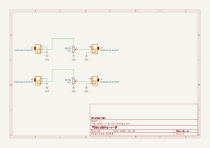
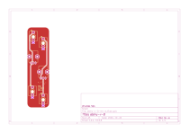

# atenu

Atenuador pasivo doble eurorack: dos canales independientes, cada uno con una entrada, un potenciómetro y una salida.

## Revisiones

- `v0.1 rev-a`: diseñada en octubre 2026 y fabricada en JLCPCB. Funciona, pero los potenciómetros quedaron al revés: girando en sentido horario baja el volumen.
- `v0.1 rev-b`: en desarrollo. Corrige la huella de los potenciómetros.

## Cómo funciona

Cada canal es un divisor de voltaje: la señal de la entrada llega a un extremo del potenciómetro, el otro extremo va a GND, y la salida sale del cursor. La salida es una fracción de la entrada, entre 0 (silencio) y 1 (la misma señal). atenu es pasivo: no necesita alimentación, no amplifica y no invierte.

Las entradas tienen el switch del jack conectado a GND, así que sin cable enchufado la salida queda en 0 V.

## Manual de uso

### Qué necesitas

- Un espacio de 5 HP en un rack eurorack. atenu no se conecta al bus de alimentación.
- Cables de 3.5 mm mono.

### Conexión

Visto de frente, el canal 1 está en la columna izquierda y el canal 2 en la columna derecha, un poco más abajo. En cada columna, de arriba hacia abajo:

1. Entrada (J1 en el canal 1, J3 en el canal 2).
2. Potenciómetro (RV1 en el canal 1, RV2 en el canal 2).
3. Salida (J2 en el canal 1, J4 en el canal 2).

Gira el potenciómetro en sentido horario para subir el nivel de la salida. En las placas rev-a es al revés: en sentido antihorario sube el nivel.

### Advertencias

- La salida tiene la impedancia del potenciómetro (hasta 25k con el potenciómetro a la mitad), así que una entrada de baja impedancia en el módulo siguiente baja un poco el nivel. Con una entrada típica de 100k la diferencia es pequeña.
- atenu solo atenúa: para invertir o amplificar una señal hace falta un módulo activo.

## Esquemático y placa (v0.1 rev-a)

Generados automáticamente por GitHub Actions a partir de `hardware/atenu-v-0-rev-a/atenu-v-0-rev-a.kicad_sch` y `.kicad_pcb` en cada push que los modifica.

## Bill of materials (v0.1 rev-a)

Generado a partir de `hardware/atenu-v-0-rev-a/atenu-v-0-rev-a.kicad_sch`.

<!-- BOM_TABLE_START -->

| Referencias | Cantidad | Valor | Huella | Descripción |
| --- | --- | --- | --- | --- |
| J1, J2, J3, J4 | 4 | AudioJack2_SwitchT | atenu-v-0-rev-a:Jack_3.5mm_QingPu_WQP-PJ398SM_Vertical | Jack mono 3.5 mm, QingPu WQP-PJ398SM (tipo Thonkiconn), vertical, THT |
| RV1, RV2 | 2 | B100k | atenu-v-0-rev-a:POT_TH_Alps_RK09K_Single_Vertical | Potenciómetro lineal 9 mm, Alpha RD901F (Thonk), vertical, THT |

6 componentes en total.

<!-- BOM_TABLE_END -->

## Créditos

- Aarón Montoya-Moraga: investigación, esquemático, PCB, panel, fabricación y documentación.

## Licencia

El hardware está bajo CERN-OHL-P-2.0 y esta documentación bajo CC-BY-SA-4.0. Ver [LICENSE.md](https://github.com/piruetasxyz/atenu/blob/main/LICENSE.md).
